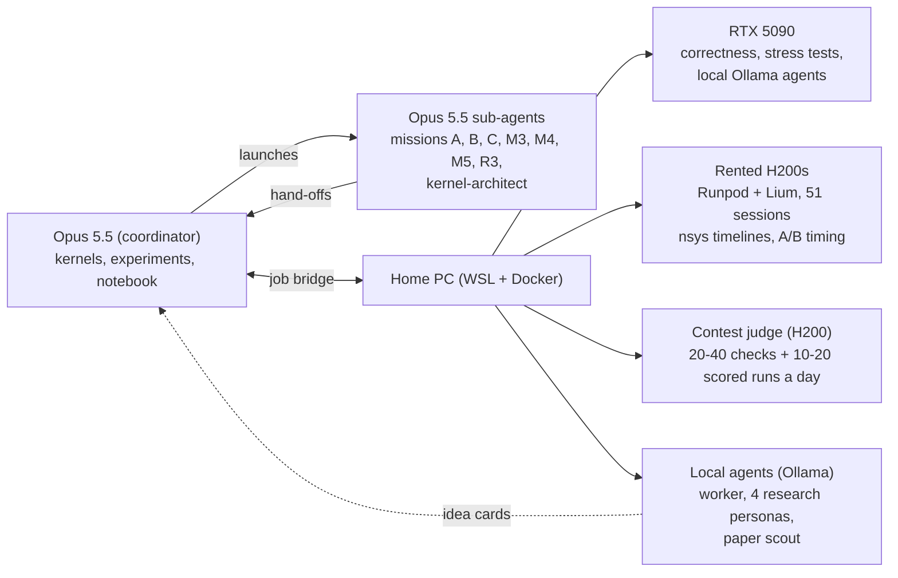

# Open Kernel Challenge submission: a full MoE decoder layer 2x faster than SGLang on an H200

For two weeks in October–November 2026 I competed in the **Muse Spark Open Kernel Challenge**. The task was to make
one complete decoder layer of a mixture-of-experts LLM (attention, router, NVFP4 experts, every norm and residual)
run faster than SGLang's implementation on an NVIDIA H200. More than 2,000 teams entered.

The setup: one long Claude Opus 5.5 session acted as coordinator. It wrote the CUDA kernels, planned the experiments
and kept the lab notebook, which was its only memory across context resets. A job bridge connected it to a home PC
(WSL + Docker) that ran everything else:

- an **RTX 5090** for correctness, race and stress tests, plus local Ollama agents that proposed ideas;
- **rented H200s** (Runpod and Lium) for timing A/Bs and nsys timelines;
- the **contest judge**, an H200 with a daily budget of checks and scored runs.

When the work split into independent tracks, Opus 5.5 sub-agents ran them in parallel and handed their results back.
GPU rental came to 51 pod sessions and **at least 66 GPU-hours and $290** (see `results/gpu_spend.json`).

**Result (best submission `decode_v482`): 2.06x SGLang overall, up to 2.32x on single-request decode.**
Final standings: rank 516 of 1,299 on the decode-layer board and 516 of 2,014 overall (the overall board is ordered
by the decode-layer board). The winner reached 2.61x and the median team 1.79x. The kernels and tools here are our own work;
the solution still imports a few SGLang kernels for fallback paths and the 128–256-token norms. The judge's results
are included, and so is everything that failed.

## What's in the box

| Folder | What it is |
|---|---|
| `solution/decode_layer.py` | The judged submission, one file (993 KB: Python + 25 embedded CUDA modules compiled at prepare time) |
| `solution/decode_layer_annotated.py` | The same code before comment stripping: every design decision explained in place |
| `solution/other_boards/` | Our best submissions on the other four boards (attention decode 2.32x, MoE W4A16 2.04x, BF16 projections 1.43x, prefill layer 1.35x) |
| `kernels/decode_layer/` | The 25 CUDA modules extracted from the submission, one file each (see `kernels/README.md`) |
| `kernels/experimental/` | Work that was built but not shipped: m4 with cross-team work stealing, and the one-launch front-of-layer megakernel (`megakernel/`) |
| `tools/lab/` | The local judge (`harness.py`), the static rules check, the H200 gate |
| `tools/agents/` | The local agents: an edit-test worker, persona research agents and a paper scout (local Ollama models) |
| `tools/build/` | Builders that turn one version into the next, the size slimmer, the in-prepare probe builder, the figure scripts |
| `tools/probes/` | Measurement scripts: nsys timeline extraction, judge-like routing statistics, the probe test driver |
| `tools/infra/` | The job bridge between Claude, my PC, the 5090 and rented H200 pods, and the GPU spend ledger |
| `notebook/` | The lab notebooks, uncurated: 1,000+ lines of what we tried, measured and learned, plus every mission log |
| `results/` | Final per-case judge result, full judge history (165 runs), GPU spend, leaderboard snapshots |
| `docs/` | The readable versions: how it works, the agents, how we tested, lessons |

## How it works, in one picture

At decode batch sizes a decoder layer barely does any math. It reads 140–200 MB of dense weights plus about 28 MB per
active expert and touches each byte once, so the job is moving bytes at the H200's 4.8 TB/s peak (about 4.3 TB/s in practice) and hiding every gap
between kernels. Our first version, built on SGLang's code path, ran about 20 kernels per layer through
general-purpose libraries. The final one runs 6 to 10 kernels per layer, almost all of them our own (at 128–256
tokens the dense projections still use cuBLAS):

- **Weights stream once, as few bytes as possible.** C12, a lossless 12-bit encoding of BF16 weights, cuts 25 % of
  the projection bytes with bit-exact results. NVFP4 expert weights are decoded straight into tensor-core operands.
- **Kernels overlap instead of queueing.** Each kernel starts loading its own weights while the previous one is
  still finishing (programmatic dependent launch), so the timeline above has no idle gaps.
- **Fewer, fused kernels.** Norms and residuals are fused into the projections around them. At 1–8 tokens one
  persistent kernel does router, routing, pooler and all experts.
- **A kernel per regime.** 1 token, 2–16, 17–32 and 128–256 tokens each get their own MoE and attention kernels,
  autotuned on the judge's GPU during prepare.

The full explanation, with numbers for each step, is in [`docs/HOW_IT_WORKS.md`](docs/HOW_IT_WORKS.md).

## The setup: a coordinator, sub-agents and local helpers

Who did what, which agent produced which kernel, and what each piece of hardware was for:
[`docs/AGENTS.md`](docs/AGENTS.md) and [`docs/TESTING.md`](docs/TESTING.md).

## The hardware, and what held us back

### What limits a decode layer on the H200

- **HBM bandwidth.** At 1–32 tokens one layer reads 140–200 MB of dense weights plus about 28 MB per active expert,
  and uses each byte once. The floor is those bytes at about 4.3 TB/s (the 4.8 TB/s peak is not reachable in
  practice): 40 µs for single-request sliding decode, where we finished at 74 µs.
- **The L2 can't hold a layer.** Its 50 MB is less than one layer's weights, so every call streams them from HBM.
  Prefetching the next kernel's weights into L2 never paid off: HBM was never idle long enough.
- **Issue slots in the expert kernels.** Turning NVFP4 weights into tensor-core operands costs about 2.4 instructions
  per weight. Keeping pace with HBM takes about 80 % of every SM's issue slots, so the expert kernels ran at
  2.5–3 TB/s, not 4.3.
- **Waiting between kernels and between CTAs.** Each kernel boundary costs about 1 µs unless the next kernel starts
  loading its weights early (PDL). A hand-off between CTAs inside one kernel costs about 1–2 µs per round trip while
  HBM is saturated, which is why our megakernels never pulled ahead.
- **Cluster placement.** Only 15 clusters of 8 CTAs fit on the chip at once, so a persistent cluster kernel gets 120
  of the 132 SMs.
- **Power.** The H200 SXM is a 700 W part. On a pod capped at 630 W, the expert kernel's clock fell from 1.74 to
  0.58 GHz halfway through.

### What the RTX 5090 can't tell you

- **A different architecture** (sm_120): no wgmma, no TMA multicast, no FA3 build, and 99 KB of shared memory per
  block instead of the H200's 227 KB. The Hopper kernels only ran there as test copies with smaller rings.
- **A different memory system:** about 1.8 TB/s of GDDR7 and a 96 MB L2. In a test loop the 28 MB of qkv weights stay
  in L2, so the 5090 times a memory-bound kernel as if it were compute-bound.
- **More SMs** (170 vs 132), so persistent kernels sized to the grid behave differently.

That made it the correctness lab, and a free one: races, wrong answers, deadlocks, thousands of fresh-input replays,
SASS reading. Its timings never picked a winner.

### Why we rented H200s

The 5090 can't give three things: timing on the real GPU (A/B between candidates), nsys timelines of a whole layer,
and profiler counters. Each rental was for one of those, for a specific question:

| When | Where | Pods | What for, and what went wrong |
|---|---|---|---|
| Oct 24–26 | Runpod, H200 SXM, $5.29/h | 11 | First real timings: the harness against SGLang, the prepare-time tuner, the first attention and verify kernels. A stopped pod often couldn't restart ("host full"), so every pause meant a new pod, and one container never started. |
| Oct 26–28 | Lium, H200 SXM / NVL / spot, $3.3–3.75/h | 18 | Cheaper, and its nodes allowed profiler counters: the first real profile and nsys timelines, attention and projection-engine probes. The NVL nodes run at 600 W and lower clocks than the judge's SXM, and spot nodes vanished mid-run. |
| Oct 29–30 | Runpod + Lium | 11 | Deep probes of the projection engines and C12, and an H100 rented for its profiler counters when the H200 nodes on offer had them disabled. |
| Oct 31–Nov 3 | Lium, H200 SXM, $3.6–4.2/h | 11 | The sub-agents' timing rounds (expert kernels, the one-launch FFN, attention) and the last MoE timelines at the judge's load. One node had a 630 W power cap, which is how we found the throttling; two lost their rounds to a full disk and a failed image pull. |

### What held the research back

- **A noisy, rationed judge.** 20 checks and 10 scored runs a day (doubled on the last days), with about ±1 % noise
  overall and ±2–5 % per case. One check can't confirm a 0.5 % idea, and submitting the best of several checks
  selects luck: submissions landed 1–2 % below the check that picked them.
- **No measurement matched the judge.** The 5090 is a different GPU, pods differed in power caps and NVL vs SXM, our
  harness ran a lighter MoE load than the judge for most of the contest, and the judge's own per-kernel profiles run
  eagerly, without the PDL overlap the score depends on. The fix was to measure on the judge's GPU itself: "lab"
  builds used the spare prepare time to run our probes there.
- **Isolation lies.** A kernel or config that wins alone can lose once its neighbours overlap it (the tuner's picks,
  both megakernels). Only whole-layer timing settled it.
- **One file, 1 MB.** The submission is a single Python file under 1,000,000 bytes that carries 25 CUDA modules. Late
  in the contest, every new kernel had to pay for its bytes by stripping or dropping something else.
- **A 300 s prepare.** Every module compiles and tunes inside `prepare()`, cold, on the judge. When the judge's
  environment changed mid-contest, prepare ran out of time until unfinished tunes learned to fall back to defaults.
- **Pods are slow to become useful.** A 27-minute image pull, full disks, hosts that couldn't restart a stopped pod,
  disabled counters, spot nodes disappearing: a good share of the rented hours went to setup.
- **Context resets.** The coordinator's context reset many times. The lab notebook was its only memory, and every new
  context started by re-reading it.

## Ten lessons

1. **Measure exactly the workload you are scored on.** Our local harness sent tokens to experts 0–31 instead of the
   judge's busiest 32-expert range. At batch 1 the MoE did about 2.5x less work locally, which hid a 10 µs gap for
   days.
2. **Read the scoring formula before optimizing.** Here, 1 µs saved on single-request sliding decode was worth as much
   as 15 µs on batch-32 full verify.
3. **Profiles can lie.** PDL overlap works inside CUDA graphs but silently does nothing on PyTorch's default stream,
   so an eager-mode profile shows no overlap at all.
4. **Lossless compression beats clever math when you are bandwidth-bound.** C12 was one of our biggest wins.
5. **A megakernel is not automatically faster.** Our first fusion of the whole front half of the layer into one
   persistent kernel lost 9–14 %: inside one kernel the dependency chain left HBM idle. A leaner version on the last
   day (qkv and attention only) was 9 µs faster than the production front on its own, but at most 1.6 µs of that
   survived inside the layer, because the chain of overlapping kernels was already hiding the front.
6. **The winner's curse is real.** Submissions landed 1–2 % below the check that selected them, because we picked
   the luckiest run.
7. **Judge noise is ±1 % overall and ±2–5 % per case.** A single check cannot confirm a 0.5 % idea.
8. **Cheap pods have cheap power budgets.** A 630 W pod throttled the expert kernel to a third of its clock
   mid-kernel. Check `clocks_event_reasons` before trusting a number.
9. **Your own GPU is for correctness, not speed.** The 5090 caught races and wrong answers for free, but its timings
   said little about the H200.
10. **Write everything down.** The notebook was the only memory that survived context resets, and most good ideas
    came from re-reading it.

The long version: [`docs/LESSONS.md`](docs/LESSONS.md).

## Running it

The submission targets the contest's image (`lmsysorg/sglang:dev-muse-spark-open`) on an H200. `prepare(weights)`
compiles its CUDA modules in parallel threads and tunes on the GPU (about 90 s), and `kernel_fn(data, state)` is the
timed call. The interface is in `solution/decode_layer_annotated.py`; the problem definition (`reference.py`,
`TASK.md`) belongs to the organizers and is not included. Several paths are Hopper-only (wgmma, TMA multicast,
clusters). On other GPUs the code falls back to slower paths, and `tools/build/mk_loc5090.py` builds the test copy we
used on the RTX 5090.

## Credits

- The Muse Spark Open Kernel Challenge organizers, for the problem, the judge and the per-kernel profiles.
- SGLang, the baseline and the starting point of our first version.
- vjeux's public solution, which we studied and benchmarked against for design ideas (none of its code is included).
- Claude (Anthropic), the other half of the team.

## License

Apache-2.0. See `LICENSE`.
